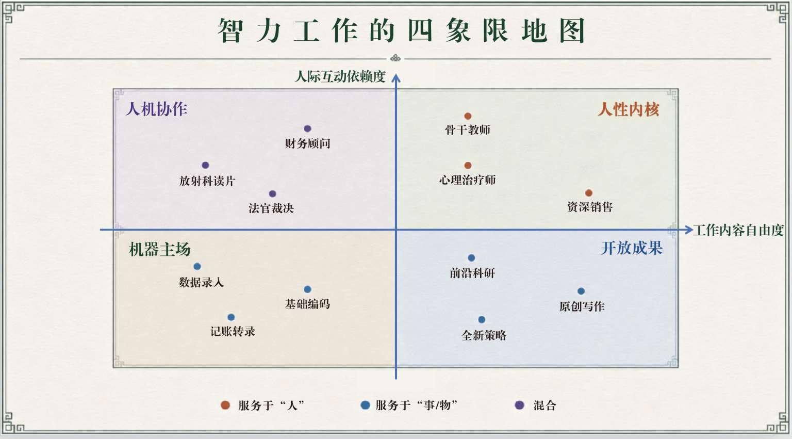
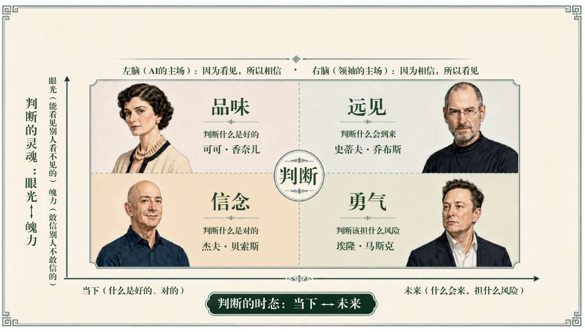

# 快刀广播站：共读《AI未来已来》

## 来源与范围

登录得到 AI 学习圈后，从第993期依次通过“上一节课”核对并读取第992、991、990期正文。这里总结的是快刀青衣对李开复《AI未来已来》的四期解读，不等同于独立读完全书。节目转述的案例、数字与预测均不当作本次另行核验的事实。

| 期数 | 文字稿 | 核心问题 |
|---|---|---|
| 990 | [之一：你也在用AI，但你用出了什么？](https://aiquan.dedao.cn/learn?id=EBOqDNZ27YlVdwWpjrKm4bQ1odMAkg) | AI 投入如何变成业务结果？ |
| 991 | [之二：你的老板，可能比你先被AI改变](https://aiquan.dedao.cn/learn?id=Qe6EGjvO7zRKZqopNwXnDrkMLPgAp9) | AI 如何减少管理层接收的信息失真？ |
| 992 | [之三：什么样的人，在AI时代的公司里会越来越值钱？](https://aiquan.dedao.cn/learn?id=Yejy8dqoQD9JoQWwxdKR1r0xpgmWk3) | 执行能力变得容易获得后，组织怎样分工、如何衡量人的价值？ |
| 993 | [之四：当AI越来越擅长执行，人靠什么立足？](https://aiquan.dedao.cn/learn?id=2GB1my8okM5VMnorOBJWgNnEe4Z73r) | 哪些任务更容易交给机器，哪些判断仍需要人负责？ |

## 一句话理解

AI 降低了部分认知和执行工作的成本。要把这变成经营成果，组织需要让真实信息进入决策，让有权限的人承担结果，并把人的时间用于定义问题、处理取舍与承担后果。

## 逐篇提炼

### 一、从“接上了”到“用出结果”

快刀用工厂电气化作类比：只换动力来源，保留旧布局、分工和流程，技术红利就很难释放。企业采购模型、培训员工、让 AI 写周报，都可能有局部收益，但转型要看真正改变了什么业务环节，是否改善了经营指标。可以先问一个朴素的问题：如果不汇报使用人数、模型数量和试点数量，还能拿出什么成果？

- **莫拉维克悖论：对人容易的，对机器不一定容易。** 对计算机而言，像成人一样下棋、做数学题，相对容易；而像一岁小孩一样爬行、抓东西、认人脸，涉及感知、身体控制或适应真实环境，反而可能更难。不能用人对任务难易的感受，去预测机器学习这些任务的先后。
- **杰文斯悖论：效率上升可能释放被压抑的需求。** 节目用蒸汽机举例：煤用得更有效率，采用蒸汽动力的行业和场景变多，煤炭总消耗反而可能增加。对应到 AI，单次生成、分析、试错变便宜后，原先做不起或不值得做的任务也会被提上日程，连带增加筛选、验证和决策工作。**AI 越强、越便宜，人反而可能越忙**；这取决于新增需求有多少，不是效率提升的必然结果。
- **接上技术，不等于用出成果。** Token 像电：动力变得便宜易得，但要让它在工厂发挥作用，远不止接一根电线。买了大模型、接了 API、做了几轮培训，如果组织、流程和人的分工没变，局部产出可以增加，最终交付却未必改善。要改的是工作如何从输入走到可验收的结果。

### 二、老板 AI 的价值是把不同证据摆在一起

快刀提到，管理最让他头疼的往往不是定战略，而是落实：战略会上大家都答应，没人公开反对，现实里却迟迟没有行动。职位越高，反而可能离一线发生的事越远。信息有三种常见失真：**有损压缩**是逐层汇总丢掉细节和例外；**信息茧房**是部门各握一部分事实却看不到彼此；**主动过滤**是报坏消息有代价，于是风险被淡化、推迟或省略。正式报告和工作记录都可能不完整，最有用的是相互印证。

节目举了三类例子：项目汇报说正常推进，但工作痕迹停滞；合同合规，却与销售承诺或交付工单对不上；工程师的贡献不显眼，但质量记录和对同事的帮助可能补充另一面。**“老板 AI”的用处，是把平时不会放在一起看的记录摆到同一张桌上。** 差异让值得查证的问题浮现出来，也让会上的承诺可以追踪到兑现或未兑现；它本身不等于真相。

**整理者的边界：** 没有代码提交不等于没人工作，行为变化也不能直接证明某人准备离职。让 AI 提示异常后，由有权接触资料的人核验事实、听当事人说明并决定如何处理。不能把“更透明”理解成无边界收集个人信息或凭 AI 推断给员工定性。

### 三、从管理人数，转向看一个人能对什么结果负责

第三篇的“微型 CEO”强调主动定义目标、调动资源、使用 AI 完成执行，并对结果负责。AI 可以减少部分执行和协调成本，因此小团队或个人也可能承担更大的任务，带多少人不再是衡量影响力的唯一方式。

节目用扁平化组织实验和客服自动化案例提醒：减少层级或人数并不会自动带来更好的组织。原来由人完成的协调、例外处理、客户沟通和判断，必须重新安排。重点是先弄清人与 AI 怎样分工，而不是从裁员目标倒推工具。

实践上，可以观察谁主动用 AI 解决真实问题、能交付结果并愿意复盘。对于管理者，认可也应落在业务成果、可靠判断和带动他人的贡献上。

### 四、判断任务，而不是给职业贴“安全”标签

第四篇用两个维度看任务：**工作内容有多少自由度、完成它有多依赖人与人之间的互动和信任**。据此重新分工：**执行更多交给 AI，判断更多留给人。** 规则明确、结果容易核验、由谁做并不重要的部分，更适合尝试自动化；没有标准答案、要理解情境并承担后果的部分，应保留人作判断。一个岗位通常同时包含这两类任务。

图一（用户提供）：横轴为工作内容自由度，纵轴为人际互动依赖度。低自由度、低人际依赖是「机器主场」；低自由度、高人际依赖是「人机协作」；高自由度、低人际依赖是「开放成果」；高自由度、高人际依赖是「人性内核」。用它拆解任务，不给整个职业贴固定标签。

创意也要拆开看：你是在用可追溯的模板做变体，还是在提出一个原先没有的选项？已有范式的重组、模板化初稿，可以大量借助 AI；发现被忽略的需求、质疑已有选项的前提，则是更难交给机器的工作。节目把工作中一个个无标准答案、需要人负责的选择称为“微决策”。

**品味的核心，是在别人没看到问题的地方看到问题。** 用户补充的香奈儿案例里，当时人们默认女装只能在舒适和好看之间二选一，她不接受这个前提。用男士内衣面料做女装，让衣服不靠束身也显得漂亮；给手袋加链条肩带，让人不必一直用手拎着。两个设计背后的判断是同一个：**好的东西，不该让人为美牺牲自由。**

共读最后把判断拆成四种：**品味**决定什么算好，**远见**判断什么可能到来，**信念**决定什么是对的、值得坚持，**勇气**决定愿意承担什么风险。普通人可以先在输得起的小事上练习：选一个方案，写下理由与止损条件，观察后果再复盘。这里的勇气不等于盲目押注。

图二（用户提供）：以「当下—未来」和「眼光—魄力」组织四种判断，分别以香奈儿、乔布斯、贝索斯、马斯克示意。图中「左脑／右脑」是表达判断方式的比喻，不是神经科学结论。

## 我的理解与团队实践（用户补充）

「老板 AI」不必从做一个新工具开始。更值得先问的是：**团队能不能有一种信息透明的文化，让坏消息及早被看见，让大家能把不同来源放在一起核对？** 可以立刻试着把周报、月报、知识沉淀和项目管理结合起来，减少重复抄写，也让战略决定能追踪到项目里的实际动作。

**可试做的最小版本（AI 整理建议）：** 先选一个在做的项目，用现有项目记录作为事实来源。周报只提炼本周承诺、实际进展、证据和需要谁作决定；月报回看反复出现的卡点，已验证的做法或经验再沉淀进知识库。让 AI 在授权范围内标出「汇报已推进但还没有验收证据」之类的差异，由当事人核实；会上确定下一步和负责人。KPI 先看关键问题从提出到作出决定的时间，以及按期交付是否有验收证据，不考核写了多少页或谁报的风险最少。尤其不要让早报风险的人吃亏，否则信息仍会被过滤。

## 综合理解（AI 整理）

这四期谈的是同一条链：**经营结果决定改什么，一线证据帮助看清发生了什么，明确的责任与权限决定谁来推进，人的判断决定下一步该做什么。** 缺其中一环，AI 可能只是把原本就存在的问题处理得更快。

与之前讨论的“局部尽责、整体失责”相关的是：AI 可以把问题单、试验记录和项目承诺对起来，提早显示卡点；但如果无人有权作决定，或没人愿意为整体结果投入资源，信息更清楚也未必会带来行动。更值得先验证的场景，是一项已有明确责任人、可以取得授权数据、改善能够被观察的真实工作。衡量的是等待是否减少、判断是否更有依据、结果是否改善，而非 AI 生成了多少文档。

同样，AI 让试验更便宜，会带来更多选项。把节省的时间全部用于增加工作，可能只会增加复核与决策负担。一个新的管理问题是：哪些选择值得做，哪些即使便宜也应该停止？

## 资料留存

保存原创总结、用户补充和四篇来源链接。两张用户提供的 PNG 原图已原样保存在 `assets/047-ai-future/`，正文使用相对路径引用；备份或移动笔记时请一并保留图片目录。未另存完整文字稿或音频。

书单状态：李开复《AI未来已来》原书待读，四篇共读文字稿已读并整理。见[书目总索引](../index.csv)。
